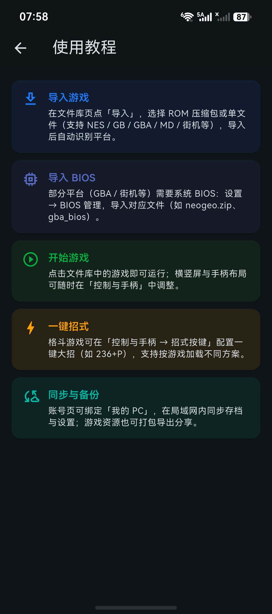
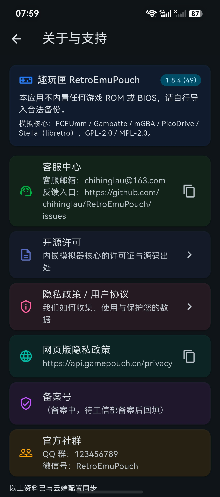
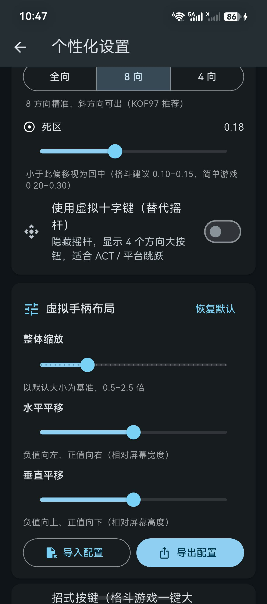
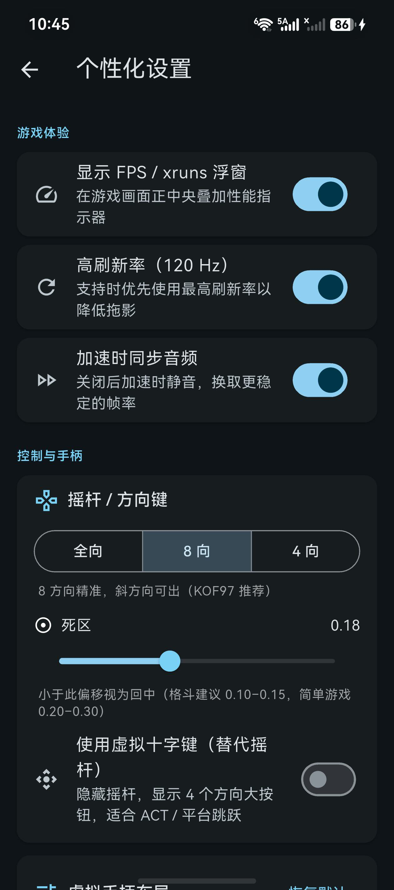
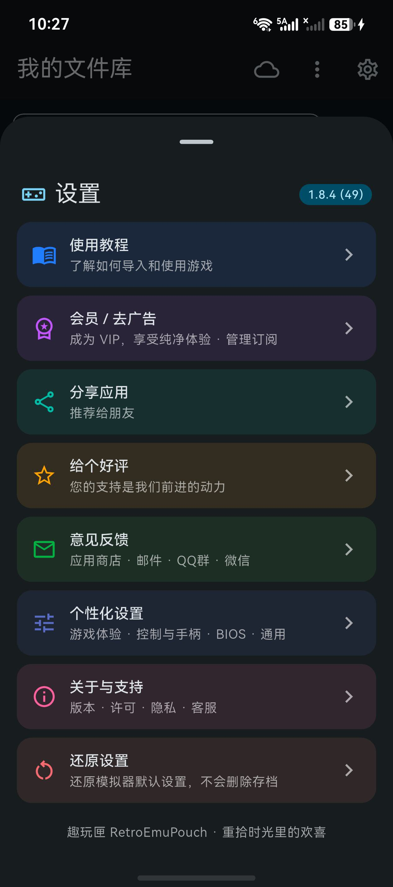

# 趣玩匣(RetroEmuPouch)复古游戏模拟器软件 用户操作手册

**软件版本：V1.8.4**　　　　　**适用平台：Android 8.0+ / HarmonyOS NEXT（API 26）+**

> 本手册为「计算机软件著作权登记」所需之文档鉴别材料（用户操作手册）。
> 文中「图 N」共 5 张，均为本软件在 HarmonyOS Pura70 真机上的**纯 UI 界面**实拍截图，
> 不含任何游戏 ROM 画面、游戏名称或 BIOS 内容；含图页面文字行数可少于 30 行（合规允许）。
> 本软件不内置、不分发任何 BIOS 或游戏 ROM，所有游戏资源须由用户从自身合法拥有的副本导入。

---

## 第 1 章 软件概述

### 1.1 软件简介
趣玩匣（RetroEmuPouch）是一款跨平台复古游戏模拟器与游戏库管理软件，支持 Android 与 HarmonyOS NEXT 系统。软件业务界面由 Flutter（Dart）实现，Android 端以 Kotlin、HarmonyOS 端以 ArkTS 实现原生模拟运行时，底层通过 libretro 接口加载模拟内核。软件本身不提供任何游戏内容，仅提供对用户合法持有之游戏备份的导入、组织、运行与存档管理能力。

### 1.2 设计目标
本软件的设计目标包括：第一，以一套统一界面覆盖多种复古平台，避免用户为不同主机安装多个模拟应用；第二，将 ROM、系统文件（BIOS）、存档、金手指、封面等数据以清晰的目录结构集中管理，并支持打包导出以便在设备间迁移；第三，提供低延迟的虚拟手柄、可缩放平移的布局与可配置的一键招式；第四，通过局域网联机与伙伴设备互传，实现低云依赖的本地多人对局与文件共享；第五，所有用户数据存放于 App 私有目录，文件读写优先使用系统文件选择器，减少权限索取。

### 1.3 主要功能一览
1. 多内核模拟：内置 libretro 架构内核，覆盖 FC/NES、GB/GBC、GBA、MD/Genesis/32X、Atari 2600 与街机平台。
2. 游戏库管理：ROM 单文件导入、资源包/ZIP 导入、搜索、平台筛选、四种排序、最近游玩与「继续游戏」入口。
3. 系统文件管理：识别并批量导入、导出、删除 `neogeo.zip`、`qsound.zip`、`pgm.zip`，缺失时启动前拦截提示。
4. 虚拟手柄：全向/8 向/4 向摇杆、死区调节、虚拟十字键、整体缩放与水平/垂直平移、布局配置导入导出。
5. 一键招式：格斗游戏招式浮层，支持脚本编辑、档案管理与 JSON 配置导入导出。
6. 存档能力：电池存档自动落盘，另有三个即时存档槽供手动存/读。
7. 游戏辅助：金手指、1/2/4/6/8 倍加速档、加速时同步音频开关、FPS / xruns 浮窗。
8. 局域网能力：伙伴设备配对与互传、双人锁步联机大厅（主机/客机、准备、对局状态）。
9. 资源包：多选游戏后打包 ROM、金手指、存档、封面与系统文件为单个 ZIP，并可反向导入。
10. 账号与服务：注册登录、会员与去广告、免费试用、云存档上传下载（两个默认关闭的自动开关）。
11. 个性化与合规：深色主题、FPS 浮窗、高刷新率、记住上次进度等设置；使用教程、关于与支持、开源许可、隐私政策与用户协议。

### 1.4 运行环境
- 硬件：arm64 架构的智能手机或平板电脑。
- 系统：Android 8.0（API 26）及以上，或 HarmonyOS NEXT（兼容 SDK 26.0.0）及以上。
- 联网：账号、云存档与伙伴发现需网络；局域网联机与互传要求设备处于同一局域网。
- 文件访问：导入与导出均通过**系统文件选择器**（Android SAF / HarmonyOS 文件选择器）完成，写入 App 私有目录；软件未申请外部存储读写权限。
- 已声明权限范围：两端均包含互联网访问；Android 端另含网络状态与 Wi-Fi 组播（用于发现局域网伙伴）。软件不申请通知、后台常驻或外部存储权限。

### 1.5 安装与首次启动
从应用商店或官方分发渠道安装后点击桌面图标启动。首次启动展示用户协议与隐私政策同意页，确认后进入游戏库。软件不会在启动时弹出存储权限请求；需要导入文件时，由用户在系统文件选择器中主动授权具体文件。

---

## 第 2 章 安装与首次配置

### 2.1 Android 平台安装
在应用商店搜索「趣玩匣」或安装官方 APK。安装包标识为 `com.retroemupouch.app`。安装完成后直接启动，按首次启动页提示阅读并同意用户协议与隐私政策即可进入主界面。

### 2.2 HarmonyOS NEXT 平台安装
通过华为应用市场或企业分发渠道安装 HAP 包，bundleName 同为 `com.retroemupouch.app`。首次启动流程与 Android 一致；软件不需要用户手动开启存储权限，文件导入在系统文件选择器中完成。

### 2.3 首次启动后的建议配置
1. 在「设置 → 使用教程」阅读内置的五步引导：导入游戏、导入 BIOS、开始游戏、一键招式、同步与备份。
2. 若准备运行街机平台的游戏，先在「设置 → 个性化设置 → 系统文件（BIOS）」导入所需系统文件。
3. 在「设置 → 个性化设置 → 控制与手柄」按握持习惯调整摇杆模式与手柄布局。
4. 通过游戏库右上角菜单加入至少一个游戏文件，完成一次导入到启动的完整流程。

### 2.4 设置中心的打开方式
游戏库顶部工具栏提供齿轮形「设置」按钮，点击后从底部弹出设置面板。设置采用「分类入口 + 子页」结构，主菜单共八个入口：使用教程、会员/去广告、分享应用、给个好评、意见反馈、个性化设置、关于与支持、还原设置。

---

## 第 3 章 游戏库主界面

### 3.1 界面布局
软件以游戏库为唯一主页面，不设底部导航栏。顶部工具栏依次为搜索框、多选/排序控件、导入菜单、伙伴入口与设置按钮；主体为游戏卡片网格；顶部另有「继续游戏」快捷横幅，用于一键恢复上次游玩的游戏。

### 3.2 搜索与排序
搜索框支持按名称以及「双人」「金手指」「存档」等索引关键字实时过滤。排序提供四种方式：按名称、按发行日期、按文件大小、按最近游玩。平台筛选用于按 FC、GB、GBA、MD、街机等类别浏览。

### 3.3 卡片信息与详情页
卡片显示封面（若存在本地封面文件）、名称与平台标签等信息。点击卡片进入详情页，以只读方式展示平台、开发商、发行商、发行日期、游戏人数、文件大小、CRC32、最近游玩与简介，并列出该游戏已关联的金手指；详情页底部提供「开始游戏」与「删除」两个操作。

### 3.4 最近游玩与继续游戏
软件记录最近一次启动的游戏；开启「记住上次进度」后，游戏库顶部显示「继续游戏」横幅，点击即以原内核与平台参数直接启动，无需重新查找游戏。

### 3.5 多选模式与导出入口
长按或点击多选控件可进入多选状态，选中若干游戏后，底部出现「导出资源包（n）」按钮。资源包导出功能位于多选模式与右上角菜单中，不在游戏详情页内。

---

## 第 4 章 导入游戏与系统文件

### 4.1 导入 ROM 单文件
在右上角菜单选择「导入 ROM（单文件）」，通过系统文件选择器选择文件。软件按扩展名与 `rom_index.json` 中记录的平台字段确定平台，并映射到对应内核；导入的文件复制到 App 私有 `files/roms/` 目录并建立索引。

### 4.2 导入资源包与 ZIP
选择「导入游戏资源包 / ZIP（自动识别）」，软件解析包内清单（资源包清单 `schemaVersion` 为 2），还原其中的 ROM、金手指、存档、封面与系统文件，并合并进现有游戏库。

### 4.3 伙伴设备互传
在「发现·伙伴」中与同一局域网内的 PC 或另一台设备配对后，可拉取对方共享的 ROM、金手指、封面与系统文件。拉取到的文件同样写入 App 私有目录，并沿用对端提供的 CRC 作为身份键，保证存档与金手指正确关联。

### 4.4 系统文件（BIOS）管理
在「设置 → 个性化设置 → 系统文件（BIOS）」打开管理卡片，列表按「已安装 / 缺失 / 其他」分组，并提供「批量导入」「导出全部」「刷新」「删除」操作。当前识别三个系统文件：`neogeo.zip`（NeoGeo）、`qsound.zip`（Capcom Q-Sound 机型）、`pgm.zip`（IGS PGM）。启动街机游戏前若核心所需系统文件缺失，软件弹出「缺少系统文件（BIOS）」对话框拦截启动，并给出批量选择入口。

### 4.5 支持的文件格式与内核
扩展名到平台的识别在 `rom_entry.dart` 中定义，平台到内核的映射如下：FC/NES（`.nes` 等）→ `fceumm`；GB/GBC（`.gb`、`.gbc`）→ `gambatte`；GBA（`.gba`）→ `mgba`；Atari 2600（`.a26`）→ `stella2014`；MD/Genesis/32X（`.md`、`.gen`、`.32x` 等）→ `picodrive`；街机与 NeoGeo（`.zip`）→ 商店版与鸿蒙版 `mame`、Android 社区版 `fbalpha2012`。SNES、PS1、N64、NDS、PSP 等扩展名可被识别为平台，但当前版本尚无对应内核，启动时会提示「该核心将在后续里程碑提供」。

> 合规说明：软件只负责读取与组织文件，不内置、不分发任何游戏 ROM 或系统文件；用户须对导入内容的合法性自行负责。

---

## 第 5 章 启动游戏与虚拟手柄

### 5.1 启动游戏
在详情页点击「开始游戏」，软件按索引中的平台与内核参数调用原生模拟运行时，加载 ROM 并进入全屏模拟页面。若该平台尚无对应内核，软件会提示「该核心将在后续里程碑提供」并拒绝启动。

### 5.2 虚拟手柄
模拟页面覆盖一层可操作的虚拟手柄：左侧为方向控制，右侧为动作按键。摇杆支持「全向 / 8 向 / 4 向」三种模式与死区调节，也可切换为虚拟十字键；整体缩放与水平、垂直平移可在设置中调整，调整结果立即生效并持久化。

### 5.3 街机专用按键
运行街机平台游戏时，虚拟层额外提供「开始」「投币」以及玩家切换按钮，用于替代街机基板上的对应输入。

### 5.4 手柄布局配置的导入与导出
在「设置 → 个性化设置 → 控制与手柄 → 虚拟手柄布局」中可「导入配置」「导出配置」「恢复默认」。配置文件为 JSON，仅包含缩放与平移等布局参数，不含任何游戏内容，便于在多台设备间复用。

---

## 第 6 章 运行中功能面板

### 6.1 功能面板入口
模拟页面提供「功能」按钮，展开后为单机模式下的六个操作：加速、摇杆、重开、金手、存档、读档。右上角「✕」用于退出到游戏库。进入联机锁步模式后，功能面板仅保留「暂停」，以避免两端状态不一致。

### 6.2 即时存档与读档
「存档」将当前状态写入即时存档槽，「读档」打开槽位选择对话框。共提供三个槽位，界面以「读取存档（n/3）」标识；尚无手动存档时给出提示。电池存档由内核在运行与退出时自动落盘，与即时存档分开管理。

### 6.3 金手指
「金手」打开当前游戏的金手指列表，可逐条启用或关闭。金手指数据按 ROM 的 CRC 关联，避免不同游戏之间的条目串用；条目来自用户导入的配置或伙伴互传。

### 6.4 加速与音频
加速按钮在 1、2、4、6、8 倍之间循环切换，界面显示「加速×N」。设置项「加速时同步音频」默认开启；关闭后，加速状态会自动静音，回到正常速度时恢复音频。软件未提供独立的音量或静音按钮。

### 6.5 帧率浮窗与显示
设置项「显示 FPS / xruns 浮窗」控制运行时左上角的帧率与音频欠载计数显示；「高刷新率（120 Hz）」用于支持高刷的设备。联机会话中另有网络与联机状态指示。

### 6.6 联机对局
联机会话由「发现·伙伴」相关页面中的联机大厅与邀请对话框发起，界面使用「主机 / 客机 / 准备 / 对局」等状态描述，内部以房间标识关联会话。建立连接后两端采用锁步同步，双方在各自设备上使用虚拟手柄操作；任一方退出即回到单机状态。

### 6.7 退出到游戏库
点击「✕」退出模拟页面，运行时先保存电池存档与运行状态，再返回游戏库。建议通过此入口正常退出，避免强制杀进程导致尚未落盘的进度丢失。

---

## 第 7 章 一键招式编辑器

### 7.1 入口与作用
在「设置 → 个性化设置 → 控制与手柄」中打开「招式按键（格斗游戏一键大招）」。编辑器管理若干招式档案，每个档案包含最多六条招式，运行时在模拟页面的「招式」浮层中以按钮形式提供，用于简化格斗游戏的指令输入。

### 7.2 招式脚本语法
脚本采用小键盘方向记法，数字 1 至 9 分别对应左下、下、右下、左、中性、右、左上、上、右上；数字 5 表示中性方向帧。按键字母为 `P`（轻拳）、`H`（重拳）、`L`（轻踢）、`K`（重踢），大小写不敏感。方向串与按键组之间用 `+` 连接，例如 `236+P`（下、右下、右后接轻拳）、`623+P`、`214+K`、`236236+PK`。多个方向的连续输入直接连写数字；脚本中的空白字符会被忽略。编译器不支持逗号分隔，遇到非法字符或按键会给出明确的错误提示。

### 7.3 内置预设与档案
软件内置默认档案，包含波动、升龙、旋风、超必杀、闪避、翻滚等六条常用招式，并预置一个空白档案供用户自行填写。用户可新建、重命名档案，为档案设置游戏提示，并指定当前生效的档案（对应配置字段 `activeProfileId`）。

### 7.4 配置的导入与导出
编辑器支持导出为 `moves-<档案标识>.json`，也可导入同格式的配置文件。顶层字段为 `version`（整数，当前为 1）、`activeProfileId` 与 `profiles`；每个档案含 `label`、`gameHints` 与 `moves` 数组，数组中每条形如 `{ "label": "...", "script": "236+P" }`。档案标识是 `profiles` 对象的键，不单独序列化。导入时会校验 JSON 结构与脚本合法性。

### 7.5 生效链路
配置保存至 App 私有目录的 `library/moves.json`。Android 与 HarmonyOS 的原生模拟运行时在启动时读取该文件并注入虚拟手柄的招式浮层；若文件缺失或为空，则回退使用内置六条默认招式。

---

## 第 8 章 设置中心

### 8.1 主菜单结构
设置面板主菜单共八个分类入口：使用教程、会员/去广告、分享应用、给个好评、意见反馈、个性化设置、关于与支持、还原设置。「分享应用」采用复制分享文案到剪贴板的方式实现，不调用系统分享面板。

### 8.2 个性化设置 · 游戏体验
包含三个开关：「显示 FPS / xruns 浮窗」「高刷新率（120 Hz）」「加速时同步音频」。三者分别控制运行时帧率浮窗、高刷设备适配以及加速状态下的音频行为。

### 8.3 个性化设置 · 控制与手柄
包含「摇杆 / 方向键」卡片（模式分段、死区滑块、使用虚拟十字键）、「虚拟手柄布局」卡片（整体缩放、水平平移、垂直平移、恢复默认、导入/导出配置）以及招式编辑器入口。

### 8.4 个性化设置 · 云存档
包含「启动时检查云端存档」「退出游戏后自动上传存档」两个开关，二者默认关闭，属用户主动开启的可选项。云同步另需已登录会员并已设置云存档密码。

### 8.5 个性化设置 · 系统文件（BIOS）
即 4.4 节所述的管理卡片，用于街机平台所需系统文件的批量导入、导出、刷新与删除。

### 8.6 个性化设置 · 通用
包含「记住上次进度」与「深色主题」两个开关。前者控制「继续游戏」横幅，后者切换界面明暗配色。全部设置项合计十三个，Android 与 HarmonyOS 共用同一套 Dart 设置模型；HarmonyOS 端另以 App 私有目录中的 JSON 文件兜底持久化，避免系统偏好服务不可用时设置丢失。

### 8.7 关于与支持
「关于与支持」子页展示软件名称、版本与合规声明，并列出模拟内核名单（FCEUmm、Gambatte、mGBA、PicoDrive、Stella 等 libretro 内核）、客服中心、开源许可、隐私政策/用户协议入口、网页版隐私政策地址、备案号与官方社群。「还原设置」可将全部设置项恢复默认值。

---

## 第 9 章 资源包、云存档与伙伴互传

### 9.1 导出资源包
在游戏库进入多选模式并选中若干游戏后，点击「导出资源包（n）」。导出对话框可勾选五类内容：ROM 游戏文件（必含）、金手指、存档、封面、BIOS 系统文件。软件打包为 `游戏资源包-N个游戏-日期.zip`，包内清单记录 `schemaVersion` 与 `appVersion`，便于对端校验。导出完成后通过系统文件选择器写入用户指定位置，可用文件管理器、USB 或蓝牙拷贝。

### 9.2 导入资源包
通过「导入资源包 / ZIP」选择已导出的包，软件自动识别清单并合并 ROM、金手指、存档、封面与系统文件，导入结果给出「已导入资源包」提示。该机制用于设备更换或离线迁移，不需要云端中转。

### 9.3 云存档
登录会员并设置云存档密码后，可在账号页手动上传或下载存档。若开启 8.4 节的两个自动开关，软件会在启动时检查云端存档、在退出游戏后自动上传。云同步失败通常与账号状态、云存档密码或网络有关，可在账号页核对。

### 9.4 伙伴设备互传
「发现·伙伴」通过局域网广播发现可配对设备，完成配对后即可浏览对端共享的 ROM、金手指、封面与系统文件并拉取到本地。该能力用于无公网环境下的资源交换，与资源包导入互为补充。

---

## 第 10 章 账号、会员与合规

### 10.1 账号
软件提供注册、登录与密码找回。账号用于会员权益、云存档与伙伴配对，不影响纯本地的游戏导入与运行功能。

### 10.2 会员与去广告
设置中心的「会员 / 去广告」子页展示免费试用、普通 VIP 与超级 VIP 档位及对应权益；用户可在不登录的情况下继续使用本地功能。

### 10.3 隐私政策与用户协议
首次启动展示同意页；设置中的「隐私政策 / 用户协议」入口打开隐私政策页面，页面内另提供网页版隐私政策地址。独立的用户协议页由同意流程跳转。软件不以任何形式在鉴别材料中展示第三方游戏画面或名称。

### 10.4 合规声明
本软件为原创开发，集成的模拟内核以开源协议提供；软件不内置、不分发任何游戏 ROM 或 BIOS，用户须自行导入合法备份。软件内「关于与支持」页亦载明同一声明，与手册口径一致。

---

## 第 11 章 故障速查

### 11.1 启动与加载
- 提示「该核心将在后续里程碑提供」：该平台尚无可用内核，当前版本仅完成扩展名识别。
- 提示「缺少系统文件（BIOS）」：在「设置 → 个性化设置 → 系统文件（BIOS）」批量导入对应文件后重试。
- 启动后黑屏：确认文件格式与平台映射正确，并检查 ROM 文件是否完整。

### 11.2 运行与存档
- 加速时无声：检查「加速时同步音频」是否被关闭；该开关关闭后加速状态自动静音属预期行为。
- 帧率显示缺失：在「个性化设置 → 游戏体验」开启「显示 FPS / xruns 浮窗」。
- 进度丢失：通过「✕」正常退出到游戏库，避免强制杀进程；电池存档在退出时落盘。
- 手柄位置不合适：在「虚拟手柄布局」中调整或「恢复默认」，必要时导入既有配置。

### 11.3 数据与同步
- 资源包导入无反应：确认选择的是本软件导出的 ZIP 或单文件 ROM，且清单结构完整。
- 云同步失败：核对登录状态、会员权益、云存档密码与网络连接；两个自动开关默认关闭。
- 伙伴设备不可见：确认两端处于同一局域网，且网络权限与组播未被系统限制。

---

## 第 12 章 版本与版权

- 软件名称：趣玩匣(RetroEmuPouch)复古游戏模拟器软件
- 版本号：V1.8.4
- 支持平台：Android 8.0+ / HarmonyOS NEXT（API 26）+
- 版权声明：本软件为原创开发；内置模拟内核以开源协议提供；游戏 ROM 与 BIOS 由用户合法导入，软件本身不提供任何受版权保护的内容。开源演示素材的来源与授权说明见 `docs/freeroms/NOTICE.md` 与 `04_开源演示素材与合规说明.md`（内部备查附件）。

---

## 附录 A 术语与缩略语

### A.1 通用概念
- **ROM**：游戏软件的只读映像文件。本软件只读取用户导入的 ROM，不内置、不分发。
- **BIOS / 系统文件**：部分平台运行所需的系统级只读数据，以 zip 包形式由用户导入，例如 `neogeo.zip`、`qsound.zip`、`pgm.zip`。
- **模拟内核（core）**：以 libretro 接口封装的模拟器实现，负责载入 ROM 并产出音视频帧。本软件按平台选择内核。
- **libretro**：一套统一的模拟器 API 规范，使上层应用可用一致方式驱动不同内核。
- **平台（PlatformKind）**：本软件对 ROM 所属主机类型的内部枚举，决定内核选择与界面标签。
- **CRC32**：ROM 内容的循环冗余校验值，作为游戏、存档与金手指关联的身份键。
- **电池存档**：模拟原主机掉电后仍保留的存档，由内核在运行与退出时自动落盘。
- **即时存档**：用户手动触发的状态快照，本软件提供三个槽位。
- **金手指**：对运行内存施加的修改项，按 ROM 的 CRC32 关联到具体游戏。
- **资源包**：把 ROM、金手指、存档、封面与系统文件打包成的单个 ZIP，用于离线迁移。
- **锁步联机**：两端按相同帧序列推进模拟的同步方式，联机状态下功能面板仅保留暂停。
- **伙伴互传**：同一局域网内配对设备之间的 ROM、金手指、封面与系统文件共享。
- **SAF / 系统文件选择器**：由操作系统提供的文件选择界面，用于导入与导出，避免申请外部存储权限。
- **APK / HAP**：Android 与 HarmonyOS 的应用安装包格式。
- **FPS / xruns**：每秒渲染帧数与音频欠载计数，可在运行时以浮窗显示。
- **死区**：摇杆中心区域被忽略的位移范围，用于抑制误触。

### A.2 界面中的专有名词
- **功能**：模拟页面中的操作面板，包含加速、摇杆、重开、金手、存档、读档。
- **继续游戏**：游戏库顶部的一键恢复横幅，依赖「记住上次进度」设置。
- **个性化设置**：设置中心的子页，包含游戏体验、控制与手柄、云存档、系统文件（BIOS）、通用五个分组。
- **系统文件（BIOS）**：设置中心中的管理卡片，列表按「已安装 / 缺失 / 其他」分组。
- **招式按键**：面向格斗游戏的一键指令功能，包含招式浮层与招式编辑器。
- **发现·伙伴**：局域网伙伴发现与配对入口。

---

## 附录 B 功能模块与实现位置对照

> 本附录用于说明本手册各章描述均对应本工程自有源码，便于核对文档与软件的一致性；
> 表中路径不构成第三方代码的提交，第三方内核源码不在源程序鉴别材料范围内。

### B.1 Flutter / Dart 业务层
- 游戏库、详情页、继续游戏、资源包导出导入：`app/lib/features/library/library_page.dart`。
- 设置中心、个性化设置、系统文件管理卡片、关于与支持：`app/lib/features/settings/settings_sheet.dart`。
- 设置项模型与持久化：`app/lib/features/settings/app_settings.dart`。
- 招式编辑器与招式脚本解析：`app/lib/features/settings/special_moves_editor.dart`、`app/lib/data/play/special_moves.dart`。
- 平台/扩展名/内核映射与 ROM 元数据：`app/lib/domain/rom_entry.dart`。
- 系统文件定义与缺失检查：`app/lib/system_files.dart`。
- 资源包构建与解析：`app/lib/data/package/game_package.dart`。
- 云存档：`app/lib/data/cloud/`、`app/lib/features/cloud/`。
- 伙伴互传与联机大厅：`app/lib/features/peer/`、`app/lib/features/play/`。
- 账号、会员与试用：`app/lib/features/account/`、`app/lib/features/membership/`。
- 隐私政策、用户协议与首次启动同意：`app/lib/features/legal/`。
- 双端平台通道：`app/lib/pal/platform_pal.dart`（接口与 Android 实现）、
  `app/lib/pal/ohos_pal.dart`（HarmonyOS 实现）、`app/lib/pal/pal_factory.dart`（实例工厂）。

### B.2 原生模拟运行时
- Android：`app/android/app/src/main/kotlin/` 下的 `EmulatorActivity.kt`（功能面板与存档）、
  `VirtualPadView.kt`（虚拟手柄与招式浮层）、`LockedRom.kt`（ROM 与系统文件暂存）、
  `SpecialMovesStore.kt`（招式配置解析）、`MainActivity.kt`（平台通道）。
- HarmonyOS NEXT：`app/ohos/entry/src/main/ets/pages/EmulatorSpike.ets`（模拟页面与功能面板）、
  `app/ohos/entry/src/main/cpp/gpretro.cpp`（libretro 运行时与系统文件暂存）、
  `app/ohos/entry/src/main/ets/plugins/GamePouchPlugin.ets`（平台通道桥接）。

### B.3 构建、验证与材料生成脚本
- 应用构建：`scripts/build-apk.ps1`、`scripts/build-hap.ps1`。
- 软著鉴别材料生成：`scripts/gen_softcopyright_source.py`、`scripts/md_to_html_for_pdf.py`。
- 开源演示素材导入：`scripts/import_freeroms.py`。
- 真机兼容性与开源 BIOS 验证脚本：`scripts/ohos/`、`scripts/mame/` 下的探针与验证脚本，
  结论留痕于 `docs/freeroms/VALIDATION.md`。

（手册结束）
